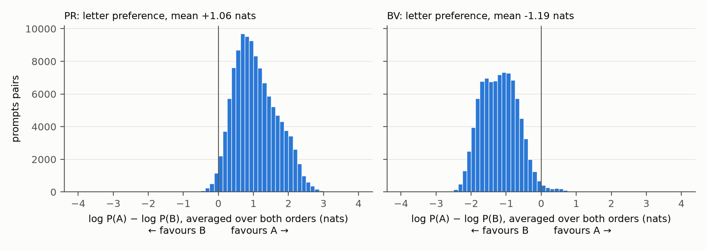
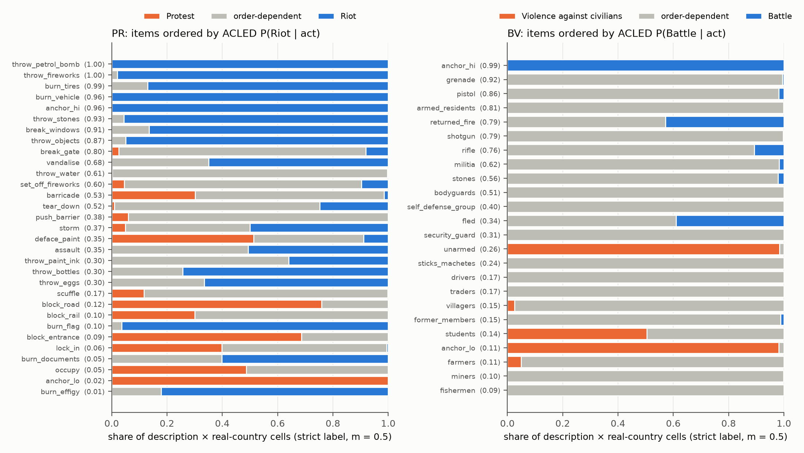
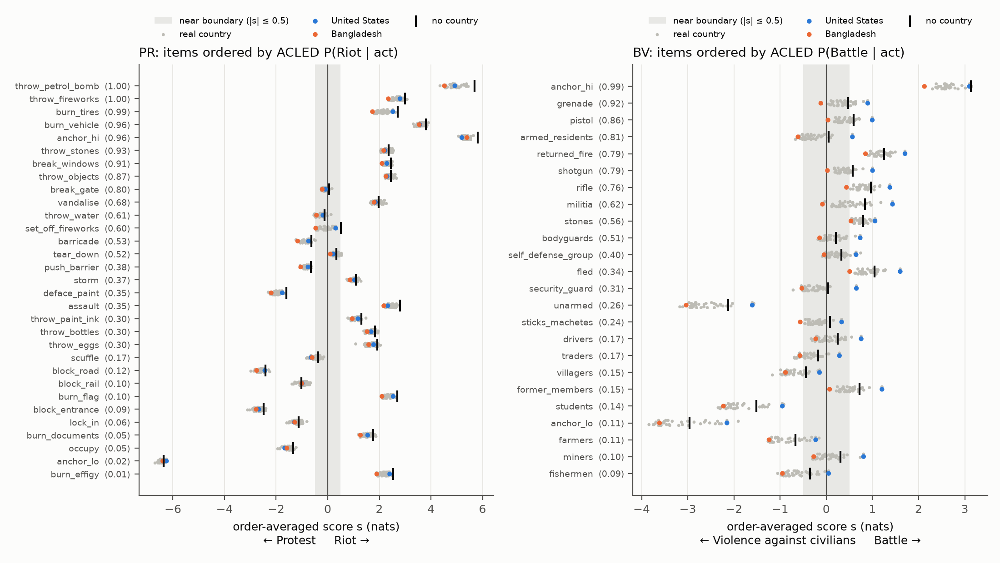
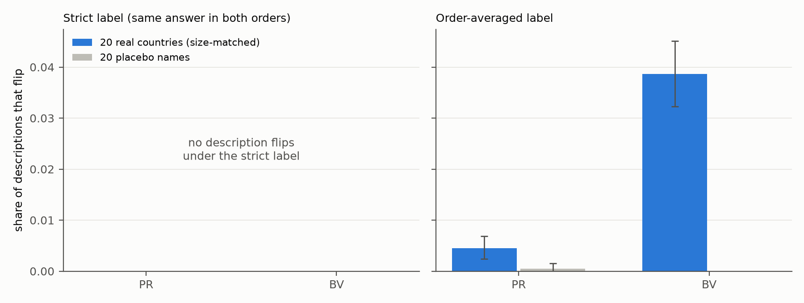
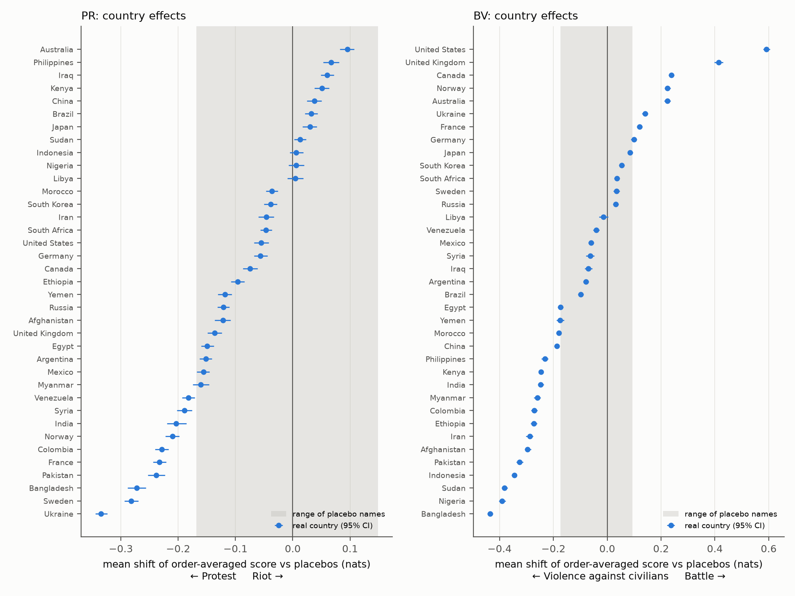
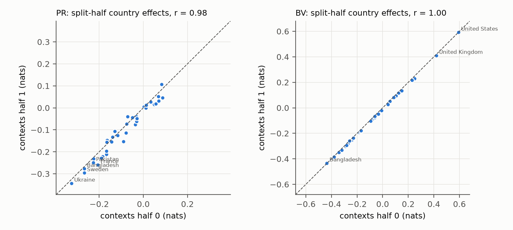

# Where an Event Happens: Country Effects in LLM Coding of Political Violence

*Preliminary behavioural report, Part 1. 8 November 2026.*

## Abstract

We ask whether a language model used to code conflict events assigns the same class to the same event regardless of where it happened.

**Design.**
- We build 3,520 event descriptions under a balanced factorial design. They vary the evidence, sentence frame, wording, actors, grievances, places and times.
- Every evidence item is an act attested in at least 20 ACLED event notes.
- Each description is rendered with no country, with 37 real countries and with 20 invented placebo names. Llama-3.2-3B-Instruct scores every rendering in both option orders, for 408,320 prompts.

**Battle vs Violence against civilians.** The country moves the model's order-averaged score in a stable, graded direction that placebo names do not reproduce.
- **Spread:** the SD of country effects is 0.23 nats, against 0.065 for placebo names.
- **Variance explained:** country identity explains 65% of the within-description variation, against 28% for placebo identity.
- **Replication:** the country ordering replicates across disjoint halves of the contexts (r > 0.99).
- **Direction:** descriptions set in the United States, the United Kingdom, Canada, Norway and Australia move toward Battle. Those set in Bangladesh, Nigeria, Sudan, Indonesia and Pakistan move toward Violence against civilians.
- **Label changes:** the shift changes the order-averaged label in 8.1% of descriptions (placebo names: 0%), all of them on evidence that sits near the decision boundary.

**Protest vs Riot.** Country effects are barely distinguishable from placebo effects.

**Under the strict criterion,** which counts a label only when it survives swapping the option order, no description changes label with the country. The model's preference for one answer letter, about 1.1 nats, is larger than any country effect. The country effect is therefore a systematic shift beneath the model's order sensitivity, decisive only where the evidence is balanced.

## 1. Introduction

Large language models are increasingly used to code text into the categories of conflict-event datasets: whether a demonstration was a protest or a riot, or whether an attack was a battle or violence against civilians. These categories feed early-warning systems, humanitarian planning and research on political violence. A coding model is only as useful as the consistency of its rules: the same event should receive the same label wherever it happened.

This report asks whether that holds. We hold a description of an event fixed, change only the name of the country in which it took place, and record the label that Llama-3.2-3B-Instruct assigns. The design isolates the country name as the only manipulated variable, so any change in the label is attributable to it.

Three features of the design make the measurement interpretable:

- **Evidence grounded in practice.** The decisive sentence in every description is an act that human coders encounter. Each act is attested in at least 20 ACLED event notes, and its position on the evidence scale is the share of those notes that coders assigned to the more severe class.
- **Systematic variation.** Descriptions vary in sentence frame, wording, evidence, actors, grievances, places and times under a balanced factorial design, so a country effect can be separated from the particular phrasing of any one description.
- **A placebo baseline.** Invented country names of matched length pass through the same pipeline and estimate how much a label moves when any name is inserted. A country effect is the part that exceeds this baseline.

This report covers the behavioural measurement (Part 1). A companion analysis (Part 2) examines why the model's labels depend on the country.

## 2. Task

The task uses two pairs of event types from the ACLED codebook that coders must distinguish routinely and that differ on a single factual question:

| Boundary | Lower class | Higher class | Deciding question |
| --- | --- | --- | --- |
| PR | Protest | Riot | Did the demonstrators themselves use violence? |
| BV | Violence against civilians | Battle | Could the targeted group fight back? |

Each pair separates a one-sided from a two-sided description of the same scene. That makes them natural test cases for whether background knowledge about a place enters the decision.

The model receives the definitions of both classes, the two options labelled A and B, and an instruction to answer with one letter (Appendix A gives the exact prompts).

## 3. Dataset Construction

### 3.1 Evidence Items

Items are drawn from 137,947 ACLED events with free-text notes (five regional exports, October 2024 – October 2025; Raleigh et al., 2010).

- **Act lexicon.** A fixed, versioned lexicon of regular expressions identifies concrete acts in the notes: throwing stones, burning tires, carrying a pistol, and so on.
- **Inclusion rule.** Every act attested in at least 20 notes becomes an item: **29 for PR and 22 for BV**.
- **Scale.** Each item's position on the evidence scale is **P(higher | act)**, the share of attesting notes that coders assigned to the higher class. It ranges from 0.01 (burning an effigy) to 1.00 (throwing a petrol bomb) for PR, and from 0.09 (the other group were fishermen) to 0.92 (one member of the other group threw a grenade) for BV.
- **Anchors.** One anchor at each end of each boundary states the class unambiguously (for example, "The two groups exchanged fire for an hour."; P = 0.99) and serves as a competence check.

Each item is written as a single sentence of 5–16 words, stated as fact. Automated rules enforce that the sentence:
- contains no hedge or modal,
- shares no word stem with the class names or definitions,
- contains no named entity, and
- uses no outcome or casualty term.

The model therefore has to infer the class from the act itself, not from vocabulary borrowed from the definitions.

### 3.2 Factorial Design

Every description combines one item with a frame, a wording and a context:

| Factor | Levels | Role |
| --- | --- | --- |
| Item | 31 PR / 24 BV, including anchors | The evidence, ordered by P(higher \| act) |
| Frame | 2 per boundary | Sentence structure of the scene |
| Wording | 2 | Fixed lexical transformations of the item sentence (for example, *threw* → *hurled*) |
| Context | 16 per boundary | PR: actors × grievance, with place balanced; BV: place × time |
| **Country** | **none, 37 real, 20 placebo** | **The manipulated variable** |

The PR contexts form a 4 × 4 Latin square: every pair of actors and grievances occurs once, and each place occurs exactly once with each actor and once with each grievance. The BV contexts cross four places with four times of day. Both designs are balanced, so the effect of each context factor is estimated independently of the others. Each context is assigned to one of two halves, which provide an internal replication of every country estimate.

Two example descriptions:

> (PR, frame f1, wording W1) A group of airport staff rallied near a train depot **in Kenya** to oppose late scholarship payments. Some participants built barricades across the road.

> (BV, frame f1, wording W1) Members of an armed group and members of another group were involved in a shooting on a coastal road **in Kenya** at dawn. The other group were farmers who carried no weapons.

The design yields **3,520 descriptions** (1,984 PR, 1,536 BV), each rendered under 58 name conditions: **204,160 texts**. The country phrase is the only difference between conditions. The build script verifies, for every description and name, that removing the phrase recovers the no-country text exactly.

### 3.3 Countries and Placebo Names

- **Real countries:** 37, covering every world region and including the ten countries of the authors' behavioural study of LLM conflict coding. Names are inserted in their natural form, with the article where English requires it ("the United States", "the Philippines").
- **Placebo names:** 20, generated from a fixed syllable inventory with a fixed seed. Any candidate matching an ACLED place name, a world country or a single vocabulary token is rejected, and the kept names match the character-length distribution of the real names.
- **Token count:** recorded for every name, as a covariate.

## 4. Measurement

### 4.1 Model and Scoring

- **Model:** Llama-3.2-3B-Instruct (revision `0cb88a4f76`, bf16), with the standard chat template; its date header is held constant.
- **Read-out:** for each prompt we read log P("A") and log P("B") at the first answer position. Both letters are single tokens there, and together they carry essentially all of the probability mass (§ 5.1).
- **No batching:** every prompt is scored in its own forward pass, so no score depends on what else is in a batch.

For description *i*, name *c* and option order *o*, the score is

  *d*<sub>ico</sub> = log P(letter of the higher class) − log P(letter of the lower class),

so positive values favour Riot or Battle.

### 4.2 Two Option Orders

Multiple-choice answers from language models depend on which option is listed first and on the letters themselves (Zhao et al., 2021; Pezeshkpour and Hruschka, 2024; Zheng et al., 2024). To separate a country effect from these position and letter preferences, every prompt is scored in both orders, with the class definitions following the option order. Each description–country pair yields two measurements, combined in two ways:

- **Strict label.** The model's answer counts as a label only if it is the same in both orders, with a margin of *m* = 0.5 nats in each. Otherwise the pair is **order-dependent**. This is the conservative reading: a label is attributed to the country only if it survives the order swap.
- **Order-averaged label.** The score *s*<sub>ic</sub> = (*d*<sub>icA</sub> + *d*<sub>icB</sub>)/2 cancels any additive letter preference. The label is the higher class if *s* > 0.5, the lower class if *s* < −0.5, and near-boundary otherwise.

The two labels answer different questions. The strict label asks whether the country changes the answer a practitioner would receive whichever order they used. The order-averaged label asks whether the country moves the model's underlying judgement. The **letter preference**, log P(A) − log P(B) averaged over the two orders, is reported alongside as a property of the model.

### 4.3 Prompt Selection

Each boundary uses one task prompt from a set of four candidate paraphrases. The selection criterion, fixed before any country condition was scored, was anchor accuracy of at least 0.9 at both ends of the scale, in both orders, both frames, and both with and without class definitions, on a separate set of pilot contexts, with P(A) + P(B) ≥ 0.9 throughout. We use the lowest-numbered paraphrase that meets it: PR p0 and BV p3, both with anchor accuracy 1.0 (gates in `inputs/prompt_selection.json`). The criterion uses anchors only, never country conditions.

### 4.4 Analysis Plan

The analysis was specified before results were examined (`DESIGN.md` § 5).

- **Flip description:** among the 37 real countries, at least one assigns the higher class and at least one the lower class (under the strict or the order-averaged label).
- **Comparison with placebos at the pair level:** the probability that two names give confident, opposite labels.
- **Comparison with placebos at the description level:** the flip rate over 20 real countries (averaged over 500 random subsets) against the rate over the 20 placebo names.
- **Country effects:** the mean shift of *s* relative to the placebo mean for the same description.
- **Uncertainty:** bootstrap intervals over descriptions (2,000 resamples).

Two robustness checks were added once the results were in, and are marked as such where they appear:
- the flip rate with each real country left out in turn;
- the spread of country effects among names that are a single token.

## 5. Results

### 5.1 Measurement Validity

The read-out is well defined, and the model passes every anchor check.

- **Letter mass:** across all 408,320 prompts, the top token is "A" or "B". The 5th percentile of P(A) + P(B) is 0.9999 for PR and 0.9994 for BV.
- **Anchors under the order-averaged label:** accuracy is 1.0 for every anchor, boundary and name kind (no country, real and placebo).
- **Anchors under the strict label:**
  - PR: 1.0 throughout.
  - BV: 1.0 for the Battle anchor. For the Violence-against-civilians anchor, 0.98 with real countries and 0.999 with placebo names. The real-country misses (45 of 2,368 pairs) come from countries that shift toward Battle in § 5.4, mainly the United Kingdom (28) and the United States (8), where the margin falls below 0.5 in one order.

The model has a consistent preference for one answer letter (Figure 1):
- **PR** favours A, the first-listed option, by a mean of 1.06 nats (98% of description–name pairs).
- **BV** favours B, the second-listed option, by 1.19 nats (98% of pairs).

As a result, the strict label is order-dependent for 41% of PR pairs and 82% of BV pairs. The order-averaged score cancels this preference by construction, and it is the score on which country effects are measured below.



*Figure 1. Letter preference, log P(A) − log P(B) averaged over the two option orders, for every description–name pair. PR favours A and BV favours B.*

### 5.2 Labels Along the Evidence Scale

Figure 2 shows the strict label for every item, and Figure 3 the order-averaged score with one dot per real country.

**PR.** The model's labels follow the ACLED evidence scale for most items. Blocking roads, entrances and rail lines, occupations and lock-ins are labelled Protest, and throwing stones, petrol bombs and objects, breaking windows and burning vehicles are labelled Riot.

The clearest departure is symbolic burning. Burning an effigy, a flag or documents is labelled Riot (*s* ≈ 1.8–2.7), while ACLED coders assign these acts to Riot in at most 10% of notes. The task definition includes "damaging property", and the model applies it literally to objects destroyed as a gesture.

**BV.** Order-averaged scores for most items fall within ±1.3 nats of zero. The exceptions are the anchors, unarmed victims and students. When the description says whether the other group could fight back, the model separates the classes. When the evidence is a weapon or an identity alone (a pistol, armed residents, miners, drivers), the score sits near the boundary. Under the strict label most of those pairs are order-dependent.

Across both boundaries, the evidence determines most of the score, and the country moves it within a narrower band (Figure 3). That band is what the next sections measure.



*Figure 2. Strict labels by item, over all description × real-country cells. Items are ordered by ACLED P(higher | act), shown in parentheses.*



*Figure 3. Order-averaged score by item. Grey dots: each real country's mean over the item's 64 descriptions. Blue: United States. Orange: Bangladesh. Black tick: no country. Shaded band: near boundary.*

### 5.3 How Often the Country Changes the Label

**Order-averaged label** (Figure 4, Table 1).

*BV:*
- 8.1% of descriptions flip across the 37 real countries (125 of 1,536; 95% CI 6.8–9.6%).
- With 20 countries, size-matched to the placebo set, 3.9% (3.2–4.5%) flip.
- The 20 placebo names never flip a description.
- At the pair level, two real countries give confident, opposite labels on 0.088% of description × pair cells; two placebo names never do.

*PR:*
- 0.9% of descriptions flip (17 of 1,984). The size-matched rate is 0.45% (0.24–0.68%), against 0.05% for placebos.
- The excess over placebos is reliable (difference CI 0.17–0.65 percentage points) but small.

**Strict label.** No description flips in either boundary: no two names give confident, opposite answers that both survive the order swap. This follows from § 5.1. A strict flip needs a country effect that is larger than the letter preference on both sides of the boundary, and the letter preference (about 1.1 nats) exceeds every country effect in Table 2.

**Margin of zero.** Read without a margin (*m* = 0), the order-averaged score changes sign with the country in 46% of BV descriptions (placebos: 20%) and 11% of PR descriptions (placebos: 7%). The margin of 0.5 restricts the headline counts to confident labels.

**Leave-one-out (robustness check).** The BV flips are concentrated on one country.
- The United States is on the Battle side of 124 of the 125 flip descriptions.
- Without it, the BV flip rate is 1.8%, which is still above the placebo rate of 0%.
- No other country moves the rate by more than 0.7 percentage points.
- On the Violence-against-civilians side the flips are spread across many countries, led by Nigeria (84 descriptions), Pakistan (68), Bangladesh (65), Colombia (60) and Indonesia (59).

**Table 1.** Flip descriptions under the order-averaged label (*m* = 0.5), with 95% bootstrap intervals.

| | PR | BV |
| --- | --- | --- |
| 37 real countries | 0.86% (0.45–1.26) | 8.14% (6.77–9.64) |
| 20 real countries (size-matched) | 0.45% (0.24–0.68) | 3.86% (3.23–4.52) |
| 20 placebo names | 0.05% (0–0.15) | 0% |
| Size-matched − placebo | 0.40 pp (0.17–0.65) | 3.86 pp (3.19–4.54) |
| 37 real, United States left out | 0.66% | 1.76% |



*Figure 4. Share of descriptions in which 20 real countries (size-matched) or 20 placebo names produce both labels.*

### 5.4 Which Countries Move the Label, and in Which Direction

Each country's effect is its mean shift in *s* relative to the placebo mean for the same description (Figure 5). Table 2 summarises the two boundaries.

**Table 2.** Country effects relative to the placebo mean.

| | PR | BV |
| --- | --- | --- |
| SD of country effects, real (placebo) | 0.112 (0.088) nats | 0.233 (0.065) nats |
| Share of within-description variance explained by name, real (placebo) | 27% (28%) | 65% (28%) |
| Real countries outside the range of placebo effects | 10 of 37 | 25 of 37 |
| Largest shift toward the higher class | Australia +0.10 | United States +0.59 |
| Largest shift toward the lower class | Ukraine −0.33 | Bangladesh −0.44 |

**BV.** The country effect is large relative to placebos and ordered.
- **Toward Battle:** the United States (+0.59), the United Kingdom (+0.42), Canada (+0.24), Norway (+0.22) and Australia (+0.22).
- **Toward Violence against civilians:** Bangladesh (−0.44), Nigeria (−0.39), Sudan (−0.38), Indonesia (−0.35), Pakistan (−0.33), Afghanistan (−0.30) and Iran (−0.29).
- **Intervals:** every country's interval is narrow (half-width ≈ 0.01 nats).
- **Consistency across items:** the shift has the same sign on nearly every item (Figure 3). For example, a shooting of farmers "in the United States" scores closer to Battle than the same shooting with no country.

**PR.** Country identity explains no more within-description variance than placebo identity (27% vs 28%), and the effects show no regional order. The clearest common feature is a shared one: a real country name, on average, moves the score 0.10 nats toward Protest relative to an invented name (26 of 37 countries are below the placebo mean).

**Token count (S5).**
- BV effects correlate with token count (r = 0.55). This is driven by the two three-token names, "the United States" and "the United Kingdom".
- Among the 32 real countries that are a single token, the SD of BV effects is 0.19 nats, still three times the placebo SD (robustness check). The ordering from Bangladesh to Canada holds within single-token names.
- "The Philippines", which also carries an article, shifts toward Violence against civilians (−0.23). The article alone therefore does not produce the Battle shift.
- Placebo effects correlate with token count at r = 0.21 (BV) and −0.44 (PR).



*Figure 5. Country effects (mean shift of the order-averaged score relative to the placebo mean) with 95% bootstrap intervals. The shaded band spans the placebo names' own effects.*

### 5.5 Replication Across Contexts

Country effects estimated on the two disjoint halves of the contexts agree closely (Figure 6):
- **BV:** r = 0.9998 for real countries and 0.996 for placebo names.
- **PR:** r = 0.98 for both.

The high placebo correlation shows that each name, real or invented, has a stable effect of its own. Replication alone therefore does not separate a country effect from a name effect. The comparison with placebos in § 5.3–5.4 does. In BV, real countries replicate *and* spread 3.6 times further than placebo names. In PR, they replicate but spread little further than placebo names.



*Figure 6. Country effects estimated on context half 0 against half 1.*

### 5.6 Where Flips Occur

Flips are located where the evidence leaves the class open (order-averaged label).

- **By BV item.** The flips concentrate on items whose no-country score lies near zero:
  - the other group included a security guard: 67% of descriptions flip;
  - miners: 36%;
  - drivers: 30%;
  - armed residents: 30%;
  - traders: 11%.
  - Items that state the decisive fact outright (unarmed victims, returned fire, the anchors) never flip.
- **By BV context.** Flip rates are similar across times of day (6–9%) and frames (8.1% and 8.2%), and higher with wording W2 (10.5%) than W1 (5.7%). Three places give 10–11%, and the fourth, near a sugarcane plantation, gives 0.8%.
- **By PR item.** The 17 flip descriptions fall on six items with no-country scores near the boundary: defacing with paint (5), setting off fireworks (5), throwing water (3), barricades (2), a lock-in (1) and blocking a rail line (1).

In both boundaries, then, the country decides the label only where the model's reading of the evidence is close to balanced. These are not necessarily the items on which ACLED coders are most divided: the BV items that flip most have ACLED P(Battle | act) between 0.10 and 0.81.

## 6. Scope

The results describe one model with one prompt per boundary.
- **Prompt choice:** the prompts were selected for anchor accuracy (§ 4.3). The extent to which other paraphrases or models share the country ordering is a question for the final report.
- **Placebo construction:** placebo names control for the presence and length of an inserted name, not for its familiarity. A real country is a familiar, frequent string, and part of what distinguishes it from a placebo may be frequency rather than geography. The single-token analysis bounds this for token count. Part 2 addresses it directly.
- **Real-country sample:** the 37 real countries cover every region but are not a random sample of countries. Statements about regions are statements about these countries.
- **Evidence base:** the items carry the v4 evidence base. The lexicon precision audit, frames derived from ACLED notes and human labels of the descriptions (`../../CONSTRUCTION.md` Steps 2–4) will strengthen the link between the evidence scale and human judgement.
- **Placebo list:** one placebo, "Reine", is also a Norwegian village and a French word. The generator's output is used unedited. Its effect is small on both boundaries (PR +0.04, BV 0.00 nats).
- **Score resolution:** bf16 scores move in steps of about 0.06 nats, well below the effects reported.

## 7. Next Steps

1. **Part 2: why the country matters.**
   - Integrated-gradients attribution on the order-averaged logit difference, for BV descriptions near the boundary.
   - Each description is attributed with the country and with a placebo, in descriptions that flip and in descriptions that do not.
   - Predictions are fixed in advance. If the model reads the country as evidence about whether the other group could fight back, attribution to the country should rise where the evidence sentence is uninformative (security guard, miners, drivers) and fall where it is decisive (unarmed, returned fire).
2. **Frequency control.**
   - Add real but rarely mentioned places (small territories and sub-national regions) and familiar non-country names to the name set.
   - This separates familiarity from geography.
3. **Held-out replication.**
   - Re-estimate country effects on the reserved contexts (pool indices 12–19) before any further design decision.
4. **Construction Steps 2–4.**
   - Complete the lexicon audit and human labels (`../../CONSTRUCTION.md`), so that the evidence scale carries human labels as well as ACLED frequencies.

## References

- Pezeshkpour, P., and Hruschka, E. (2024). Large language models sensitivity to the order of options in multiple-choice questions. *Findings of NAACL 2024*.
- Raleigh, C., Linke, A., Hegre, H., and Karlsen, J. (2010). Introducing ACLED: An armed conflict location and event dataset. *Journal of Peace Research*, 47(5), 651–660.
- Zhao, Z., Wallace, E., Feng, S., Klein, D., and Singh, S. (2021). Calibrate before use: Improving few-shot performance of language models. *ICML 2021*.
- Zheng, C., Zhou, H., Meng, F., Zhou, J., and Huang, M. (2024). Large language models are not robust multiple choice selectors. *ICLR 2024*.

## Appendix A. Task Prompts

System prompts, verbatim from `inputs/prompts.json`. The user turn is the event description.

**PR, order A** (order B lists Riot first, with its definition first, and labels it A):

```
You code demonstration events for a conflict-event dataset. Read the event description and decide which of the two event types below it is.

Protest: a public demonstration in which participants remain nonviolent, including demonstrations that face intervention or violence from others.

Riot: a demonstration in which participants engage in violence or destruction, such as attacking people or damaging property.

A. Protest
B. Riot

Answer with one letter: A or B.
```

**BV, order A** (order B lists Violence against civilians first, with its definition first, and labels it A):

```
Below is a short report of a violent incident. Assign it to one of the two event types used in conflict monitoring that are listed below.

Battle: a fight between organized armed sides, each capable of hurting the other.

Violence against civilians: an organized armed group purposely harms unarmed civilians who are unable to protect themselves.

A. Battle
B. Violence against civilians

Give your answer as one letter: A or B.
```

## Appendix B. Released Data

| File | Contents |
| --- | --- |
| `dataset/descriptions.csv` | One row per description: all factor levels, the ACLED evidence statistics and the text template |
| `dataset/labels.csv.gz` | One row per description × name (204,160 rows: 58 name conditions, including no country): *d* in both orders, *s*, *b*, the strict and order-averaged labels, and the letter mass |
| `dataset/description_summary.csv` | One row per description: label counts by name kind, flip indicators, the real countries on each side of a flip, and the no-country label |
| `report/results.json` | Every number in this report |
