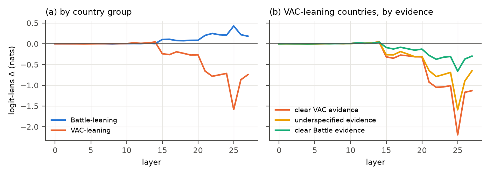
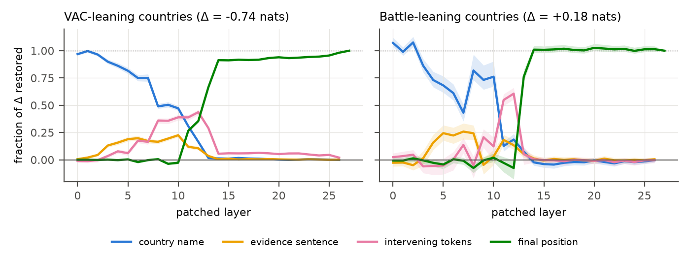
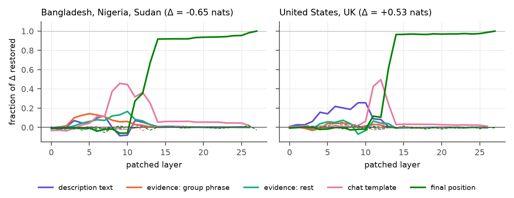
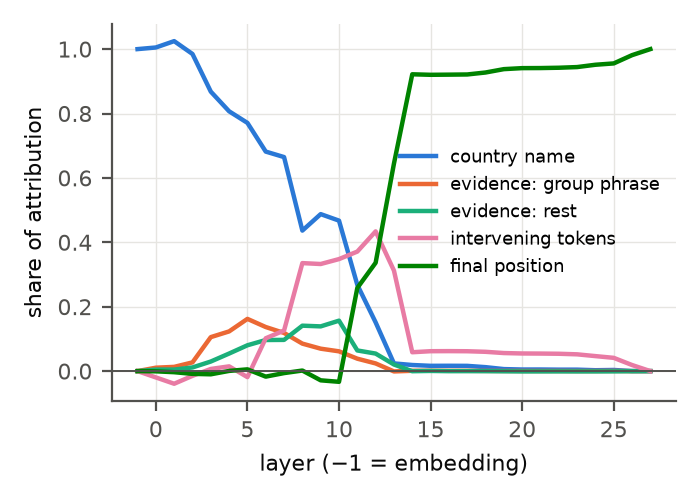
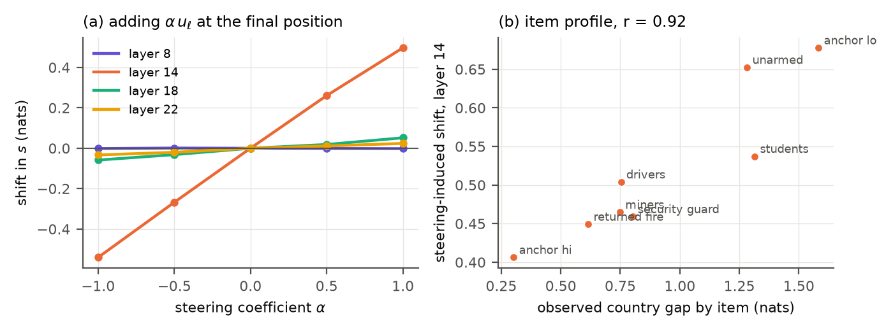
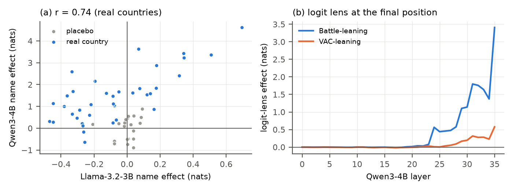

# How a Country Name Reaches a Conflict-Coding Decision in Llama-3.2-3B

*Part 2 of the country-effect study. 21 November 2026.*

## Abstract

Language models used to code conflict events change their labels with the country in which an event is set. In Part 1 we measured this effect behaviourally in Llama-3.2-3B-Instruct. Inserting a country name into an otherwise fixed event description moves the model's Battle vs Violence against civilians (VAC) decision by up to 0.6 nats. Descriptions set in the United States or the United Kingdom move toward Battle; those set in Bangladesh, Nigeria or Sudan move toward VAC.

Here we trace how the name's influence travels through the network to the answer. We compare each country prompt with a prompt that is identical except for a baseline name of the same token length. On these pairs we apply four methods:

- the logit lens;
- denoising activation patching, with a matched-norm random control;
- layer-wise integrated gradients;
- activation steering.

We find three things.

1. **The country signal reaches the answer late.** It is absent from the final position's read-out through layer 14 of 28, and appears in two steps, at layers 15 and 21.
2. **The route is a three-stage relay.** The country is carried at the name until about layer 10, and at the tokens between the name and the final position at layers 4–13 (mainly the chat-template tokens, which hold up to half of the effect). From layer 14 on it is carried entirely at the final position: patching the final position alone at layer 14 restores 91–101% of the effect. A matched-norm random control shows that these fractions are not produced by perturbation alone.
   - For Bangladesh, Nigeria and Sudan about a quarter of the effect passes through the evidence sentence on the way.
   - For the United States and the United Kingdom it passes instead through the description text after the name.
3. **A single direction carries it at that point.** The mean difference between Battle-leaning and VAC-leaning countries at the final position, added at layer 14, shifts the decision linearly: ±0.52 nats at unit strength, 56% of the gap between the two country groups. The same vector shifts clear-VAC evidence more than clear-Battle evidence, which matches the item dependence of the behavioural effect (r = 0.92 across items).

The evidence dependence of the country effect therefore does not require the country to change how the evidence is read; it arises in the layers after the final position has received the country. Qwen3-4B orders countries similarly (r = 0.74) and also receives the country signal only in its last third of layers.

## 1. Introduction

Conflict-event datasets such as ACLED (Raleigh et al., 2010) assign every event to a category, for example whether an attack was a *battle* between armed sides or *violence against civilians*. Large language models are increasingly used to apply such codebooks to text. A coding model must be invariant to facts the codebook treats as irrelevant. The country in which an event happened is one of them: the same act should get the same label in Norway and in Nigeria.

Part 1 of this study showed that Llama-3.2-3B-Instruct violates this invariance in a stable, graded way. Part 2 asks how the violation is implemented. We ask three questions:

- **When** does the country information become visible in the model's prediction?
- **Where**, in layer and token position, is the country's influence carried on its way to the answer?
- **In what form** does it reach the answer? In particular, how does one country shift produce the evidence-dependent effect seen behaviourally, largest on clear-VAC evidence and smallest on clear-Battle evidence?

The questions matter for mitigation. If the country changed how the model reads the evidence, a fix would have to intervene on evidence processing. If the country is delivered to the answer position as a separable signal, a fix can target that signal alone.

**Contributions.**

1. We build token-length-matched country/baseline prompt pairs on a factorial panel of ACLED-grounded descriptions. Within each pair the two prompts are identical except for the name, so activations can be exchanged position by position.
2. With patching and integrated gradients, we locate a relay. The name holds the country information through the early layers, the intermediate positions hold it in the middle layers, and the final position holds all of it from layer 14 on.
3. We identify a linear country direction at the final position that causally shifts the decision. It reproduces the evidence dependence of the behavioural effect without any change to the evidence tokens.

## 2. Background: The Behavioural Effect (Part 1)

**Task.** The model receives a system prompt with the definitions of two ACLED event types and the options "A. Battle" and "B. Violence against civilians" (or the reverse order), and is asked to answer with one letter. The user turn is a two-sentence description of an incident (Figure 1).

**Descriptions.**
- **Evidence items.** The second sentence states one *evidence item*: an act or attribute of the targeted group that is attested in at least 20 ACLED event notes, e.g. "The other group were farmers who carried no weapons." or "One member of the other group returned fire."
- **Evidence scale.** Each item has a position on the evidence scale, P(Battle | act): the share of ACLED notes with that act that coders labelled Battle. It ranges from 0.09 (fishermen) to 0.92 (a grenade).
- **Factorial design.** The 1,536 BV descriptions cross 24 items (including one anchor at each end of the scale) with 2 sentence frames, 2 wordings and 16 contexts (4 places × 4 times of day).

**Names.** Each description is rendered with no country, with each of 37 real countries, and with each of 20 invented placebo names, which are inserted as "… on a coastal road **in Kenya** at dawn."

**Score.** Each rendering is scored in both option orders. We write d = log P(Battle letter) − log P(VAC letter) at the answer position, and s = (d_A + d_B)/2 for the order average. Averaging removes the model's preference of about 1.1 nats for the letter B, which is independent of content.

**Behavioural findings that Part 2 explains.**
- **Spread.** Country effects, measured against the mean of the placebo names, have an SD of 0.23 nats, against 0.065 for placebos. Country identity explains 65% of the within-description variance.
- **Stability.** The country ordering replicates across disjoint halves of the contexts (r > 0.99). United States +0.59, United Kingdom +0.42, Canada +0.24; Bangladesh −0.44, Nigeria −0.39, Sudan −0.38.
- **Label changes.** In 8.1% of descriptions the order-averaged label changes with the country, always on evidence near the decision boundary.
- **Evidence dependence.** The effect varies with the evidence. It is largest where the evidence is clearly VAC, e.g. unarmed farmers.

## 3. Experimental Setup

### 3.1 Model and Notation

We study Llama-3.2-3B-Instruct (revision `0cb88a4f`), run in bfloat16 with one prompt per forward pass, exactly as in Part 1. The model has L = 28 decoder blocks and residual width 3,072.

- **Residual states.** h_ℓ,t is the residual stream after block ℓ at token position t, and h_−1,t is the token embedding.
- **Final position.** T is the last prompt token: the "\n\n" after the assistant header, at which the answer letter is predicted.
- **Score at the final position.** For a prompt x,

  d(x) = (W_U[a_Battle] − W_U[a_VAC]) · RMSNorm(h_27,T),

  where W_U is the unembedding and a_Battle, a_VAC are the two answer-letter tokens. This equals the log-probability difference, because the softmax normaliser cancels.

### 3.2 Mechanistic Panel

All experiments use a panel drawn from the Part 1 study contexts and fixed before any internal measurement. The panel has 128 descriptions: 8 evidence items × 4 contexts × 2 frames × 2 wordings. The items cover three evidence roles:

| Role | Items (ACLED P(Battle \| act)) |
| --- | --- |
| Clear VAC | `anchor_lo` (unarmed farmers, anchor), `unarmed`, `students` |
| Underspecified | `security_guard` (a night watchman), `miners`, `drivers` |
| Clear Battle | `returned_fire`, `anchor_hi` (exchange of fire, anchor) |

The countries are the five most Battle-leaning countries of Part 1 and three of the most VAC-leaning, all with names of one or three tokens:

| Group | Countries (tokens) |
| --- | --- |
| Battle-leaning | the United States (3), the United Kingdom (3), Canada (1), Norway (1), Australia (1) |
| VAC-leaning | Bangladesh (1), Nigeria (1), Sudan (1) |

### 3.3 Token-Matched Prompt Pairs

Activation patching and integrated gradients compare two prompts position by position, so both prompts must have the same length and differ only at the name.

- **Baselines.** We pair each country prompt x_c with a baseline prompt x_b, in which the country is replaced by a non-country name with the same number of tokens. The one-token baselines are Jupiter, Hogwarts and Zion; the three-token baselines are "the Upper Valley", "the Northern Territory" and "the Central Highlands". Each was drawn with a fixed seed and assigned to descriptions in rotation.
- **Checks.** Every pair is verified to be identical token for token outside the name span.
- **Effect.** The quantity we explain is the pair effect

  Δ = s(x_c) − s(x_b).

  Averaged over the panel, Δ = −0.74 nats for the VAC-leaning countries (384 pairs) and +0.18 nats for the Battle-leaning countries (640 pairs). The Battle-leaning effect is smaller than its Part 1 counterpart because two baselines themselves lean toward Battle (Hogwarts +0.50, "the Upper Valley" +0.24 against the placebo mean). The analyses therefore rest mainly on the VAC-leaning group, whose effect is larger.

### 3.4 Token Spans

Positions are resolved from character offsets in the rendered chat string, never from fixed indices. Each span is checked by decoding it back to the exact substring it covers. Figure 1 shows one prompt with its spans marked.

| Span | Tokens |
| --- | --- |
| `name` | the country or baseline name, including its leading space |
| `context` | the description text between the name and the evidence sentence |
| `ev_group` | the phrase naming the target group in the evidence sentence |
| `ev_rest` | the rest of the evidence sentence, ending with its period |
| `template` | the chat-template tokens after the description (`<\|eot_id\|>`, the assistant header) |
| `final` | the last token, T |

We call `context` and `template` together the *intermediate tokens*. `ev_group` and `ev_rest` together form the *evidence sentence*.

> **Figure 1.** One panel prompt (user turn and template tokens; the system prompt precedes it).
>
> Members of an armed group and members of another group were involved in a shooting on a coastal road **⟨in⟩ ⟦ Bangladesh⟧**`name` ⟦ at dawn.⟧`context` ⟦ The other group were⟧`ev_rest` ⟦ farmers⟧`ev_group` ⟦ who carried no weapons.⟧`ev_rest` ⟦`<|eot_id|><|start_header_id|>assistant<|end_header_id|>`⟧`template` ⟦\n\n⟧`final`
>
> The baseline prompt replaces " Bangladesh" with " Jupiter" (one token each). For this pair, d(x_c) − d(x_b) = −0.60 nats in order A.

## 4. Methods

**Logit lens.** We decode each intermediate residual at the final position with the model's own final norm and unembedding (nostalgebraist, 2020):

d^(ℓ)(x) = (W_U[a_Battle] − W_U[a_VAC]) · RMSNorm(h_ℓ,T).

We report the order-averaged pair effect at each layer, Δ^(ℓ) = s^(ℓ)(x_c) − s^(ℓ)(x_b). At ℓ = 27 this is the model's output. The lens shows when the country becomes readable as an answer preference at the final position; it does not show where the information is held.

**Activation patching.** We use denoising patching (Meng et al., 2022; Zhang and Nanda, 2024):
1. Run the baseline prompt x_b.
2. At layer ℓ, replace the residual states of a span S with their values from the country prompt x_c.
3. Let the rest of the forward pass proceed.

The restored fraction is

F_S(ℓ) = E[ s(x_b; h_ℓ,S ← h_ℓ,S(x_c)) − s(x_b) ] / E[Δ],

a ratio of means over the pairs of a country group, averaged over both option orders. F = 1 means that span S at layer ℓ carries the whole country effect.

- **Coverage.** Spans `name`, `ev_group`, `ev_rest`, the whole evidence sentence and the intermediate tokens are patched at every layer 0–26; the final position at every layer 0–27.
- **Uncertainty.** 95% intervals come from 2,000 bootstrap resamples of pairs.

**Matched-norm random control.** Replacing a residual state perturbs a bfloat16 forward pass, and in this model any perturbation moves d slightly. To separate the country's information from this perturbation floor, we repeat each patch with a control: the same positions and layer, but the baseline state is moved by a random direction whose norm equals ‖h_ℓ,t(x_c) − h_ℓ,t(x_b)‖ at each position. We report the restored fraction in excess of the control.
- **Subset.** This analysis runs on the 32 panel descriptions of one context, for Bangladesh, Nigeria and Sudan (96 pairs) and the United States and the United Kingdom (64 pairs), with `context` and `template` patched separately.
- **Precision.** d is read in float32 from the final residual: the two letter rows of W_U and the final norm are applied in float32, while the forward pass stays in bfloat16. This avoids the 0.125-nat rounding step of bfloat16 logits.

**Layer-wise integrated gradients.** For one-token countries we interpolate the name embedding from the baseline to the country, E(α) = E_b + α(E_c − E_b), with 50 midpoint steps α_k = (k + ½)/50 (Sundararajan et al., 2017). The attribution to residual state h_ℓ,t is

A_ℓ,t = Σ_k ∇_{h_ℓ,t} d(α_k) · [h_ℓ,t(α_k + 1/100) − h_ℓ,t(α_k − 1/100)].

Every layer's residual stream is a complete cut of the computation, so at each layer the attributions over positions sum to d(x_c) − d(x_b), up to discretisation. We report each span's share Σ_{t∈S} A_ℓ,t / Σ_t A_ℓ,t, order-averaged, on the 64 panel descriptions of two contexts. The forward pass is in bfloat16 with gradients accumulated in float32; the median completeness error is 0.15 nats.

**Steering with a country direction.**
- **Direction.** On the 768 BV descriptions of the *pilot* contexts (0–7), disjoint from the panel, we compute the mean final-position residual for the one-token Battle-leaning countries minus that for the one-token VAC-leaning countries:

  u_ℓ = mean over descriptions of [ mean_{c ∈ Battle-leaning} h_ℓ,T(x_c) − mean_{c ∈ VAC-leaning} h_ℓ,T(x_c) ],

  for ℓ ∈ {8, 14, 18, 22}. This is a difference-of-means direction (Marks and Tegmark, 2023; Rimsky et al., 2024).
- **Intervention.** On the baseline prompts of the panel we add α·u_ℓ to h_ℓ,T at the final position only, for α ∈ {±0.5, ±1}, and measure the change in s. At α = 1 the added vector equals the full average difference between the two country groups at that layer.

## 5. Results

### 5.1 The country signal reaches the answer late

At the final position the logit lens shows no country effect through layer 14 (|Δ^(ℓ)| ≤ 0.05 nats; Figure 2a). For the VAC-leaning countries the effect then appears in two steps: −0.24 nats at layer 15 and −0.66 at layer 21, reaching −0.74 at the output. The Battle-leaning countries show the same timing with the opposite sign. The lens overshoots at layer 25, and layers 26–27 undo part of the overshoot. The logit lens is not calibrated at intermediate layers (Belrose et al., 2023), so we read it for timing rather than magnitude.

The evidence role scales the effect but does not change its timing (Figure 2b). For the VAC-leaning countries, the final effect is:

| Evidence role | Final Δ (nats) |
| --- | --- |
| Clear VAC | −1.13 |
| Underspecified | −0.65 |
| Clear Battle | −0.30 |

The steps occur at the same layers in all three. The country signal is therefore not available as an answer preference until the second half of the network.

*Figure 2. Logit-lens pair effect Δ^(ℓ) at the final position. (a) By country group. (b) VAC-leaning countries by evidence role.*

### 5.2 The country's influence is relayed from the name to the final position

Patching locates where the country's influence is carried at each layer (Figure 3).

- **Layers 0–10: the name.** Patching the name alone at layer 0 restores the full effect (F = 0.97 for VAC-leaning countries). Its share then declines steadily, to 0.47 by layer 10 and near zero by layer 13. After that point the name position no longer holds information that later layers read.
- **Layers 4–13: the intermediate tokens and the evidence sentence.** As the name's share declines, other positions take it up.
  - The intermediate tokens peak at layer 12 (VAC-leaning 0.44, Battle-leaning 0.61).
  - The evidence sentence holds a smaller share over layers 4–10 (VAC-leaning up to 0.22, Battle-leaning up to 0.26).
- **Layers 14–27: the final position alone.** Patching only the final position restores 0.91 of the VAC-leaning effect at layer 14 and 1.01 of the Battle-leaning effect. From layer 14 to the output it stays between 0.91 and 1.03. No later layer reads country information from any other position.

The hand-off from the intermediate tokens to the final position happens over layers 11–14, immediately before the logit lens first registers the country at layer 15.

*Figure 3. Fraction of the pair effect restored by patching one span at one layer into the baseline run. Shaded: 95% bootstrap intervals over pairs. "Intermediate tokens" are the description text after the name and the chat-template tokens.*

### 5.3 The intermediate route runs through the chat template

The panel-wide patching above pools two kinds of intermediate tokens. To separate them, we repeated the patching on a subset (the 32 descriptions of one context) with the description text and the chat-template tokens patched separately, and with a matched-norm random control for every span and layer (Figure 4; § 4).

**The control stays at zero.** For every span other than the name, the random control restores less than 0.05 of the effect at every layer. The fractions reported here are therefore carried by the country's information, not by the act of perturbing the forward pass. (Replacing the name's embedding with a random vector of the same norm does move the score, by 0.26–0.30 of the effect at layers 0–2, which is expected for a token-identity position.)

**Most of the intermediate share is in the chat template.** The four template tokens between the description and the final position (`<|eot_id|>` and the assistant header) carry the largest share of any non-final span:
- 0.48 above control for Bangladesh, Nigeria and Sudan at layer 9 (95% CI 0.42–0.55);
- 0.45 for the United States and the United Kingdom at layer 12 (0.38–0.52).

These positions hold no task content, and every prompt shares them. In the middle layers they serve as the staging point from which the final position reads the country.

**The two country groups take different paths to the template.**

| Span (peak, fraction above control [95% CI]) | Bangladesh, Nigeria, Sudan | United States, UK |
| --- | --- | --- |
| Evidence sentence | **0.24** [0.20, 0.29], layer 9 | 0.12 [0.08, 0.16], layer 11 |
| of which: group phrase | 0.16 [0.12, 0.20], layer 5 | 0.06 [0.03, 0.09] |
| of which: rest of sentence | 0.19 [0.15, 0.23], layer 10 | 0.07 [0.04, 0.11] |
| Description text after the name | 0.17 [0.13, 0.21], layer 7 | **0.26** [0.22, 0.31], layer 10 |
| Chat template | 0.48 [0.42, 0.55], layer 9 | 0.45 [0.38, 0.52], layer 12 |
| Final position, layer 14 | 0.92 | 0.97 |

- **VAC-leaning countries pass through the evidence sentence.** The share moves along the sentence: first the group phrase ("farmers", "students") at layers 3–7, then the rest of the sentence up to its final period at layers 8–10. It then reaches the template.
- **US and UK pass mostly through the description text between the name and the evidence.** Their path through the evidence sentence is small.

In both groups the final position holds the whole effect from layer 14.

*Figure 4. Span patching on one context with the intermediate tokens split. Solid: fraction of Δ restored. Dashed, same colour: matched-norm random control.*

### 5.4 Integrated gradients give the same route

Layer-wise integrated gradients decompose the same pair effect by a different principle: a path integral of gradients rather than a substitution. For the VAC-leaning countries (192 pairs, Δ = −0.70 nats) the span shares trace the route found by patching (Figure 5):

- **The name** holds the attribution at the embedding (share 1.0), and its share falls to 0.47 by layer 10.
- **The intermediate tokens** rise to 0.43 at layer 12.
- **The evidence sentence** holds 0.2–0.25 over layers 5–10.
- **The final position** takes 0.64 at layer 13 and 0.92 from layer 14 onward.

The two methods agree on the layer of the hand-off. For the one-token Battle-leaning countries the pair effect (+0.10 nats) is comparable to the completeness error (0.15 nats), so we do not interpret their shares.

*Figure 5. Share of layer-wise IG attribution by span for the VAC-leaning countries (layer −1 is the embedding).*

### 5.5 A single direction at the final position carries the effect

At layer 14 the final position carries the whole country effect, so we ask whether that information is linear: can one direction, estimated on separate data, reproduce it?

**At layer 14 it can (Figure 6a).** Adding α·u_14 to the baseline prompts shifts s linearly and symmetrically:

| α | −1 | −0.5 | +0.5 | +1 |
| --- | --- | --- | --- | --- |
| Shift in s (nats) | −0.54 | −0.27 | +0.26 | +0.50 |

At α = ±1 the shift is 56% of the 0.92-nat gap between the two country groups on the panel. The antisymmetry rules out a generic perturbation effect, which would move s in the same direction for both signs.

**Its effect on each item tracks the behavioural effect (Figure 6b).** The shift induced by u_14 is largest on clear-VAC items (`anchor_lo` 0.68, `unarmed` 0.65) and smallest on clear-Battle items (`anchor_hi` 0.41). Across the eight items it correlates r = 0.92 with the observed gap between Battle-leaning and VAC-leaning countries.

The same vector, added at the same position, therefore has a larger effect when the evidence describes civilians. Because nothing upstream of the final position changes, the evidence dependence of the country effect does not require the country to alter how the evidence is read, even though part of the country's influence travels through the evidence positions (§ 5.3). It arises in how layers 15–27 turn the final-position state into a decision. The induced profile spans a narrower range than the observed one: 0.41–0.68 nats, against 0.30–1.58. A single mean direction therefore captures the shape of the item dependence but not its full size.

**The direction works only around layer 14.** At layer 8 the same construction has no effect (|shift| < 0.002 nats), consistent with the country not yet having reached the final position. At layers 18 and 22 it shifts s by at most 0.06 nats, although patching the full final-position state at those layers restores the whole effect. After layer 14 the country information at the final position is no longer captured by a mean difference over countries estimated on separate descriptions.

*Figure 6. (a) Shift in s from adding α·u_ℓ at the final position of baseline prompts, at four layers. (b) Shift induced at layer 14 (α = ±1, averaged) against the observed country gap, by evidence item.*

### 5.6 A second model

We scored the same panel with Qwen3-4B (float32, thinking disabled) for all 58 Part 1 names. Its BV country effects correlate r = 0.74 with Llama's across the 37 real countries (Figure 7a), with the United States, Australia, the United Kingdom and Canada among the five most Battle-leaning countries in both models. Its logit lens likewise registers the country at the final position only late, from layer 24 of 36 (Figure 7b). We did not run patching or IG on Qwen, because its tokenizer would require rebuilding the matched pairs.

*Figure 7. (a) BV name effects in Qwen3-4B against Llama-3.2-3B (relative to the placebo mean). (b) Qwen3-4B logit lens at the final position, by Llama country group.*

## 6. Discussion

**A relay, then a late decision.** The country does not act as a constant offset injected at the end. Its information moves forward from the name in the middle layers.
- The chat-template tokens before the answer act as a staging point.
- For the VAC-leaning countries about a quarter of the effect passes through the evidence sentence, moving along it from the target-group phrase to its final period.
- The information is gathered at the final position over layers 11–14 and turned into an answer preference over layers 15–27. This resembles the flow found for factual recall, where attributes of a subject are moved to the last position by attention in the middle layers and read out later (Geva et al., 2023). It also fits evidence that models represent places along linear directions (Gurnee and Tegmark, 2024).

**Where the evidence dependence comes from.** Behaviourally, the country effect is largest on clear-VAC evidence. One might read this as the country changing how strongly the model weighs the evidence. The steering result argues otherwise. A fixed vector at the final position, with every upstream state unchanged, produces the same item profile. The dependence is therefore a property of the late layers' read-out: the decision is more sensitive to the country direction when the final-position state encodes civilian targets. This also explains a Part 1 observation. Label changes occur only on underspecified items, not because the country acts most strongly there, but because only there does the score sit near the boundary.

**Implications for mitigation.** At layer 14 the final position holds the whole country effect, and a mean-difference direction carries more than half of it. An intervention at that single site, for example projecting out u_14, is a natural candidate for removing the country effect without altering evidence processing. Whether such a projection preserves the model's use of the evidence is a question for follow-up work.

**Limitations.**
- **Scope.** The panel covers 8 countries, 8 evidence items and 4 contexts of one model, and the per-span control covers one context.
- **Baselines.** The non-country baselines are not neutral (Hogwarts in particular leans toward Battle), which compresses the Battle-leaning pair effects. The VAC-leaning results, on which most conclusions rest, are not affected in sign.
- **Numerical precision.** Single-position effects in a bfloat16 model are close to the perturbation floor: in a check on one pair, a matched-norm random vector at a single position moved the score as much as the country's state did. We therefore report spans, where the control is near zero, rather than individual tokens.
- **Steering after layer 14.** The steering direction is a mean difference. Its failure after layer 14 shows that later country information is not linear in the same sense; it does not show that it is absent.

## References

- Belrose, N., et al. (2023). Eliciting latent predictions from transformers with the tuned lens. *arXiv:2303.08112*.
- Geva, M., Bastings, J., Filippova, K., and Globerson, A. (2023). Dissecting recall of factual associations in auto-regressive language models. *EMNLP*.
- Gurnee, W., and Tegmark, M. (2024). Language models represent space and time. *ICLR*.
- Marks, S., and Tegmark, M. (2023). The geometry of truth: Emergent linear structure in large language model representations of true/false datasets. *arXiv:2310.06824*.
- Meng, K., Bau, D., Andonian, A., and Belinkov, Y. (2022). Locating and editing factual associations in GPT. *NeurIPS*.
- nostalgebraist (2020). Interpreting GPT: the logit lens. *LessWrong*.
- Raleigh, C., Linke, A., Hegre, H., and Karlsen, J. (2010). Introducing ACLED: An armed conflict location and event dataset. *Journal of Peace Research*, 47(5).
- Rimsky, N., et al. (2024). Steering Llama 2 via contrastive activation addition. *ACL*.
- Sundararajan, M., Taly, A., and Yan, Q. (2017). Axiomatic attribution for deep networks. *ICML*.
- Zhang, F., and Nanda, N. (2024). Towards best practices of activation patching in language models: Metrics and methods. *ICLR*.

## Appendix A. Reproduction

All commands run from `interpretability/` as `python -m country_effect.part2_attribution.scripts.<script>`.

| Script | Analysis | Output |
| --- | --- | --- |
| `00_verify_parity` | parity gate: reproduces Part 1 scores to 1.2 × 10⁻⁷; hooks and patches leave logits bit-identical | `outputs/00_parity/` |
| `01_build_controls` | baseline names | `outputs/01_controls/` |
| `04_run_logit_lens` | § 5.1 | `outputs/04_logit_lens/` |
| `05_run_activation_patching` | § 5.2 | `outputs/05_patching/` |
| `05b_run_span_patching_control` | § 5.3 | `outputs/05b_span_control/` |
| `07_run_matched_ig` | § 5.4 | `outputs/07_ig/` |
| `06_run_probes_and_steering` | § 5.5 | `outputs/06_probes_steering/` |
| `08_run_generality_check` | § 5.6 | `outputs/08_generality/` |
| `09_compile_report_artifacts` | figures, `report/facts.json` | `report/` |

Every output directory has a `manifest.json` with input and output hashes, the script hash and the model revision. Scripts refuse to run unless the parity gate has passed.
