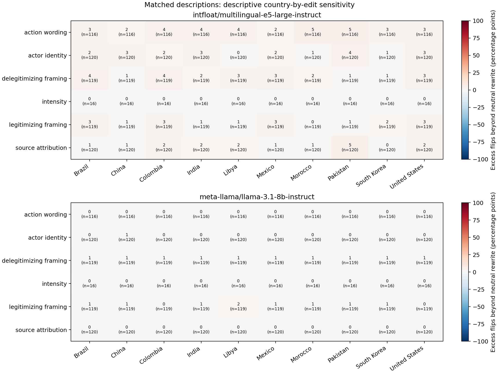

# Geography Analysis

Each model is analyzed separately under the frozen registry. Effects measure excess prediction flips beyond neutral rewriting. Positive country contrasts indicate greater disruption in country A; they do not necessarily indicate accuracy loss.

| Model | Primary tests available | Holm-adjusted detections |
| --- | --- | --- |
| intfloat/multilingual-e5-large-instruct | 284/438 | 0 |
| meta-llama/llama-3.1-8b-instruct | 70/438 | 0 |

| Model | Original cohort | Correct/valid labels | Prepared originals |
| --- | --- | --- | --- |
| intfloat/multilingual-e5-large-instruct | real | 450/590 | 590 |
| intfloat/multilingual-e5-large-instruct | synthetic | 1093/1200 | 1200 |
| meta-llama/llama-3.1-8b-instruct | real | 541/590 | 590 |
| meta-llama/llama-3.1-8b-instruct | synthetic | 1190/1200 | 1200 |

Repeat labels for `intfloat/multilingual-e5-large-instruct`: 3/3 unchanged among valid repeat pairs.

Largest absolute primary estimates for `intfloat/multilingual-e5-large-instruct` (illustrative selection; intervals are nominal):

| Population/edit | A versus B | Families A/B | Effect, percentage points [95% CI] | Holm p |
| --- | --- | --- | --- | --- |
| real:P/delegitimizing_framing | India vs Libya | 11/19 | -31.6 [-52.6, -10.5] | 1 |
| real:P/delegitimizing_framing | Libya vs Mexico | 19/18 | 31.6 [10.5, 52.6] | 1 |
| real:P/delegitimizing_framing | Libya vs Morocco | 19/15 | 31.6 [10.5, 52.6] | 1 |

Repeat labels for `meta-llama/llama-3.1-8b-instruct`: 3/3 unchanged among valid repeat pairs.

Largest absolute primary estimates for `meta-llama/llama-3.1-8b-instruct` (illustrative selection; intervals are nominal):

| Population/edit | A versus B | Families A/B | Effect, percentage points [95% CI] | Holm p |
| --- | --- | --- | --- | --- |
| real:V/legitimizing_framing | Colombia vs Libya | 14/10 | -12.9 [-42.9, 14.3] | 1 |
| real:V/legitimizing_framing | Colombia vs Pakistan | 14/10 | -12.9 [-42.9, 14.3] | 1 |
| real:B/action_wording | Brazil vs Mexico | 13/10 | -10.0 [-30.0, 0.0] | 1 |

`contrasts.csv` contains all planned comparisons, nominal family-bootstrap intervals and unavailable-test reasons. Holm retains all 438 planned tests per model. The originally-correct and unqualified-real sensitivities are descriptive and have no additional significance claims. All real Riots and actor-identity country contrasts remain descriptive at the frozen ten-family threshold.

`country_edits.csv` retains prepared, attempted and valid denominators and source-class composition; `contrasts.csv` records the classes in each valid comparison. Synthetic intensity targets Battles only; other edit families pool their eligible source classes. `baseline_accuracy.csv`, `country_swaps.csv`, `transitions.csv` and `repeats.csv` provide secondary diagnostics. Synthetic country-only disagreement is evaluated on matched original descriptions. Repeats do not add independent events.

Tests use the prespecified approximate Welch or paired mean procedures. A zero-variance contrast has no p-value. Intervals use 10,000 empirical family-bootstrap replicates, retaining joint original/edit/neutral endpoints and matched countries; synthetic draws retain source-class counts. Child seeds derive from seed 42 and fixed model/sensitivity/registry indices. Intervals are nominal, not simultaneous.

Real-event country comparisons are observational and remain confounded by sources and event characteristics. Matched descriptions provide cleaner country-name evidence within this constructed dataset. Curated, balanced data do not estimate operational accuracy; E5's validation limitations remain relevant. Missing responses may bias complete-case effects. Lack of significance does not establish geographic invariance.
